# AlumniConnect — Entity-Relationship Diagram

Matches `database/schema.sql` exactly — regenerate this if the schema changes.

```mermaid
erDiagram
    USERS ||--o| STUDENT_PROFILES : "has (if STUDENT)"
    USERS ||--o| ALUMNI_RECORDS : "claims (if ALUMNI)"
    USERS ||--o{ EVENT_REGISTRATIONS : registers
    USERS ||--o{ MENTORSHIP_REQUESTS : "sends (as student)"
    USERS ||--o{ JOB_APPLICATIONS : applies
    USERS ||--o{ NOTIFICATIONS : receives
    USERS ||--o{ AUDIT_LOGS : "performs (as admin)"
    USERS ||--o{ EVENTS : "creates (as admin)"
    USERS ||--o{ ANNOUNCEMENTS : "creates (as admin)"
    USERS ||--o{ ALUMNI_IMPORT_BATCHES : "runs (as admin)"

    ALUMNI_RECORDS ||--o{ CAREER_HISTORY_ENTRIES : has
    ALUMNI_RECORDS ||--o{ MENTORSHIP_REQUESTS : receives
    ALUMNI_RECORDS ||--o{ JOB_POSTINGS : posts

    EVENTS ||--o{ EVENT_REGISTRATIONS : has
    JOB_POSTINGS ||--o{ JOB_APPLICATIONS : receives
    ALUMNI_IMPORT_BATCHES ||--o{ ALUMNI_IMPORT_ERRORS : logs

    USERS {
        bigint id PK
        varchar email UK
        varchar password_hash
        varchar full_name
        enum role "STUDENT | ALUMNI | ADMIN"
        boolean is_active
    }

    STUDENT_PROFILES {
        bigint id PK
        bigint user_id FK
        varchar enrollment_number UK
        varchar department
        varchar batch
        json skills
        text career_interests
    }

    ALUMNI_RECORDS {
        bigint id PK
        bigint user_id FK "nullable — null until claimed"
        varchar full_name "institution-controlled"
        varchar email "institution-controlled"
        varchar enrollment_number UK "institution-controlled"
        varchar department "institution-controlled"
        smallint graduation_year "institution-controlled"
        varchar current_company "alumni-controlled"
        varchar job_title "alumni-controlled"
        json skills "alumni-controlled"
        enum status "IMPORTED|INVITED|CLAIMED|ACTIVE|INACTIVE"
        enum directory_visibility
        boolean open_to_mentoring
    }

    CAREER_HISTORY_ENTRIES {
        bigint id PK
        bigint alumni_id FK
        varchar company
        varchar job_title
        date start_date
        date end_date
    }

    ALUMNI_IMPORT_BATCHES {
        bigint id PK
        bigint admin_id FK
        varchar original_filename
        json column_mapping
        enum status
        int total_rows
        int successful_rows
        int failed_rows
        int duplicate_rows
    }

    ALUMNI_IMPORT_ERRORS {
        bigint id PK
        bigint batch_id FK
        int row_index
        varchar error_message
        json raw_row_data
    }

    EVENTS {
        bigint id PK
        varchar title
        datetime event_date
        enum mode "ONLINE | ON_CAMPUS"
        int capacity
        enum status "DRAFT|PUBLISHED|CANCELLED"
        bigint created_by FK
    }

    EVENT_REGISTRATIONS {
        bigint id PK
        bigint event_id FK
        bigint user_id FK
        enum status "REGISTERED | CANCELLED"
    }

    MENTORSHIP_REQUESTS {
        bigint id PK
        bigint student_id FK
        bigint alumni_id FK
        text message
        enum status "PENDING|ACCEPTED|REJECTED|COMPLETED"
    }

    JOB_POSTINGS {
        bigint id PK
        bigint posted_by FK
        varchar title
        varchar company
        enum status "PENDING|APPROVED|REJECTED|REMOVED|EXPIRED"
    }

    JOB_APPLICATIONS {
        bigint id PK
        bigint job_id FK
        bigint applicant_id FK
        enum status
    }

    ANNOUNCEMENTS {
        bigint id PK
        varchar title
        text content
        enum target_audience "ALL|STUDENTS|ALUMNI|DEPARTMENT|BATCH"
        enum priority "LOW|MEDIUM|HIGH"
        date publish_date
        bigint created_by FK
    }

    NOTIFICATIONS {
        bigint id PK
        bigint user_id FK
        enum category
        varchar message
        boolean is_read
    }

    AUDIT_LOGS {
        bigint id PK
        bigint admin_id FK
        enum action
        varchar details
    }
```

## Key design decisions

1. **`alumni_records` is not a subtype of `users`.** An alumni record can
   exist with `user_id = NULL` (imported, not yet claimed). This is the
   entire mechanism behind "don't create a duplicate record" — claiming
   sets `user_id` and flips `status`, it never inserts a new row.
2. **Institution-controlled vs. alumni-controlled columns live on the same
   `alumni_records` row**, split only by which service/endpoint is allowed
   to write them (see `AlumniService.adminUpdate()` vs.
   `AlumniService.updateOwnProfile()` in the backend). The database enforces
   referential integrity; the write-permission split is an application-layer
   rule, enforced in the service layer and re-checked in the DTOs so a
   request body literally cannot carry both sets of fields at once.
3. **`directory_visibility`** resolves the privacy-settings gap flagged in
   the SRS review — an explicit enum rather than a vague "respect privacy."
4. **`audit_logs` has no update/delete path anywhere in the codebase** — not
   just a permissions rule, there is no service method that would do it.
